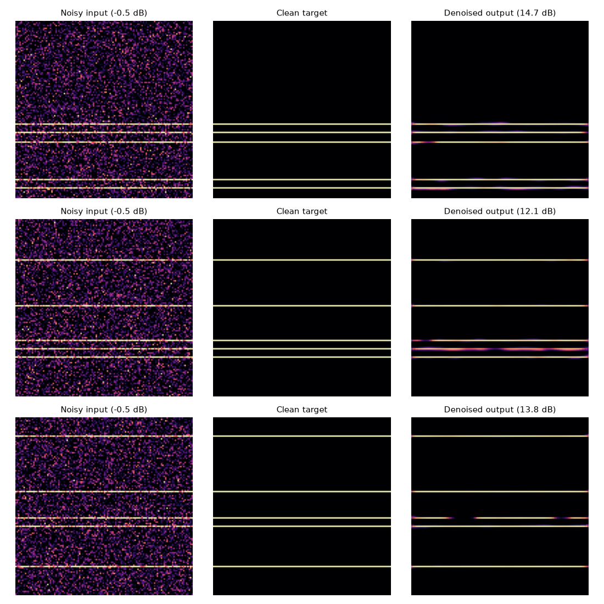
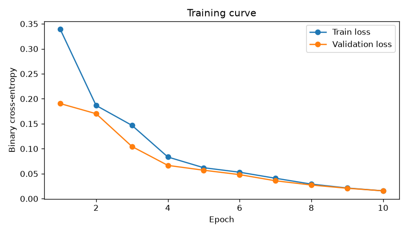
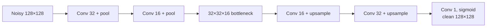

<picture>
  <source media="(prefers-color-scheme: dark)" srcset="assets/banner-dark.svg">
  
</picture>

<p align="center">
  <a href="https://github.com/ashwinpr15/audio-signal-enhancement/actions/workflows/ci.yml"></a>
  
  
  <a href="LICENSE"></a>
</p>

A convolutional autoencoder that learns to pull clean signal out of heavy noise. The inputs are 128×128 "spectrogram-like" images, where a few horizontal lines stand in for steady tones, buried under Gaussian noise.

<p align="center">
  
  <br><sub>Unseen test examples: noisy input, clean target, and the model's output.</sub>
</p>

## Results

On 50 test images the model never saw during training:

| | SNR |
|---|:---:|
| Noisy input | −0.72 dB |
| Denoised output | **12.35 dB** |
| **Average improvement** | **+13.07 dB** (worst single image: +3.99 dB) |

<p align="center"></p>

Ten epochs on 500 images take about 20 seconds on a laptop CPU. The numbers come from `results/metrics.json` and are reproducible with the fixed seeds.

### The bug that MSE hid

The first version trained with mean squared error and looked fine at a glance, but its loss went flat at the first epoch and the output SNR was exactly 0 dB. The lines cover only about 4% of each image, so predicting a blank image already scores a low MSE, and the network settled there. Switching to **binary cross-entropy**, which suits sparse 0/1 targets, fixed it: validation loss now falls every epoch and the lines come back cleanly.

## How it works



- **`src/data_loader.py`** draws five random horizontal lines per image, adds Gaussian noise (σ = 0.3) and clips to [0, 1]. A seed makes datasets repeatable.
- **`src/model.py`** is the encoder–decoder: two convolution and pooling stages squeeze the image to a quarter of its size, and two convolution and upsampling stages rebuild it.
- **`train.py`** trains on 500 images (10% held out for validation) and saves the model and training curve.
- **`analyze.py`** generates 50 fresh images with a different seed, measures SNR before and after, and saves the comparison grid and `results/metrics.json`.

## Run it

```sh
python -m venv .venv
# Windows: .venv\Scripts\activate    macOS/Linux: source .venv/bin/activate
pip install -r requirements.txt
python train.py      # ~20 s on CPU, writes models/ and results/training_curve.png
python analyze.py    # writes results/metrics.json and results/result_comparison.png
python -m unittest -v
```

Tested with Python 3.13 and TensorFlow 2.21.

## Project layout

```
├── src/
│   ├── data_loader.py     # synthetic noisy/clean image pairs
│   └── model.py           # convolutional autoencoder
├── train.py               # training
├── analyze.py             # SNR evaluation and comparison plots
├── test_pipeline.py       # fast checks: shapes, seeding, SNR maths, one training step
└── results/               # metrics and charts from the last run
```

## Good to know

- **These are images, not audio files.** The lines mimic what tones look like on a spectrogram, which makes it easy to see whether denoising works, but this repo doesn't load or play sound.
- **Next steps:** generate real spectrograms from short audio clips with STFT, train on speech mixed with recorded noise, compare against classic spectral subtraction, and turn the output back into audio to listen to the difference.

## License

[MIT](LICENSE)
