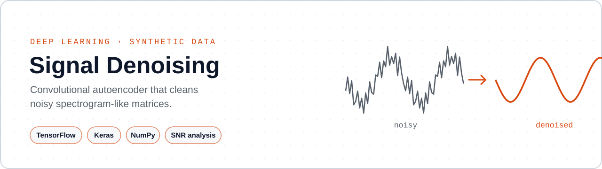

<picture>
  <source media="(prefers-color-scheme: dark)" srcset="assets/banner-dark.svg">
  
</picture>

# Synthetic signal denoising demonstration

A TensorFlow/Keras convolutional autoencoder reconstructs generated 128 by 128 line patterns after Gaussian noise is added. The inputs are synthetic spectrogram-like matrices, not recordings or transformed waveforms.

## Implementation

- `src/data_loader.py`: line-pattern generation, Gaussian noise, clipping, and channel dimensions.
- `src/model.py`: two convolution/pooling stages followed by convolution/upsampling and a sigmoid output; MSE loss.
- `train.py`: trains on 500 generated examples for 10 epochs with a 10% validation split; writes a model and loss plot.
- `analyze.py`: generates 10 new examples, compares matrix SNR, and saves a reconstruction plot.

## Run from the repository root

```sh
python -m venv .venv
# Activate the environment for your operating system.
python -m pip install -r requirements.txt
python train.py
python analyze.py
```

Outputs: `models/denoiser_model.h5`, `output/training_curve.png`, and `output/result_comparison.png`.

## Limitations

No fixed benchmark result is published yet. To report one, run the scripts and retain the environment, seed, checkpoint, and evaluation data before publishing a result. The current generator has no explicit random seed; scores can vary. Matrix SNR is not evidence of perceptual audio quality, and this project does not demonstrate waveform reconstruction or production deployment.

## License

Released under the [MIT License](LICENSE).
